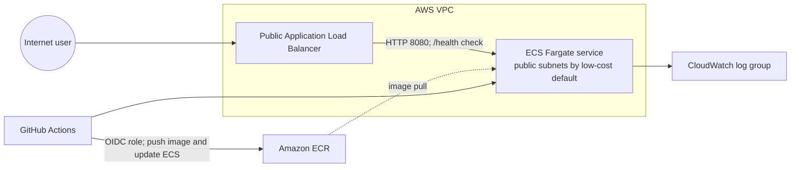

# Spring Boot on AWS ECS with Terraform

A small stateless Java REST API used to learn Docker, AWS networking, ECS Fargate, ECR, Terraform, GitHub Actions, OIDC, and CloudWatch. No AWS deployment has been run.

## Architecture



By default, ECS tasks use public subnets and receive public IPs so they can pull from ECR and send logs without a NAT Gateway or paid VPC endpoints. Their security group accepts application traffic **only from the ALB security group**. This is a cost-conscious learning setup, not the preferred design for sensitive production workloads. To move tasks to private subnets, add a NAT Gateway or required VPC endpoints, which can incur recurring charges. Optional RDS resources are disabled by default and are not connected to this stateless API.

The ALB listener is HTTP-only to avoid adding certificate/domain setup to the learning exercise. Add an ACM certificate and HTTPS listener, then redirect HTTP to HTTPS, before handling real user data.

## Technology versions

- Java 21, Maven, Spring Boot 3.5.16 (Spring Boot 3.5 requires Java 17 or newer and supports Java 21; see [Spring Boot requirements](https://docs.spring.io/spring-boot/3.5/system-requirements.html)).
- Docker multi-stage build: Maven 3.9.11 / Eclipse Temurin 21 builder and Temurin 21 JRE runtime.
- Terraform >= 1.10 and AWS provider ~> 6.66.
- GitHub Actions checkout v7.0.1, setup-java v6.1.0, AWS credentials v6.0.0, and Trivy v0.35.0 are pinned to verified upstream release commits.

## Project layout

```text
src/main/java/dev/learning/ecsapi/  API, service, configuration, error handling
src/main/resources/application.properties
src/test/                           REST endpoint tests
terraform/                          VPC, ECR, ECS, ALB, optional RDS, IAM, logs
.github/workflows/                  CI and main-branch deployment workflows
Dockerfile                          Multi-stage non-root image
docs/                               Beginner guides
```

## API

| Method and route | Result |
|---|---|
| `GET /` | JSON welcome message |
| `GET /api/hello` | `{"message":"Hello from Spring Boot running on AWS ECS!"}` |
| `GET /health` | `{"status":"UP"}`; used by the ALB target group |
| `GET /api/info` | Basic application details |
| `GET /actuator/health` | Spring Boot Actuator health endpoint |

## Local development

Install Java 21 and Maven 3.6.3 or later. No AWS account is needed for the API.

```bash
mvn clean verify
mvn spring-boot:run
curl http://localhost:8080/api/hello
curl http://localhost:8080/health
```

The API does not use a database and requires no database configuration. Terraform retains optional RDS infrastructure with `enable_rds=false` by default; enabling it incurs charges and does not connect it to this API.

## Docker

```bash
docker build -t ecs-spring-api:local .
docker run --rm -p 8080:8080 ecs-spring-api:local
curl http://localhost:8080/health
```

The image is built in two stages, runs as UID 10001, and contains only the Java runtime and packaged application. The ALB checks `/health`; the minimal runtime image has no separate in-container curl health command.

## Terraform and AWS deployment

Read [the Terraform guide](docs/terraform-guide.md) before provisioning. Terraform is not applied automatically. The deployment workflow is manual-only and can deploy to AWS when dispatched from `main`. The configuration creates real, potentially billable resources. Costs can continue until resources are destroyed; stopping ECS alone does not remove the ALB, RDS, ECR images, CloudWatch logs, or public IPv4 charges.

```bash
cd terraform
terraform init -backend=false
terraform fmt -check -recursive
terraform validate
```

The commands above are local validation only. A later deployment session is possible, but provisioning and operating AWS can incur charges. Read the [deployment and cleanup sequence](docs/terraform-guide.md) and [cost guide](docs/cost-management.md) first. No AWS resources have been provisioned by this verification.

Terraform starts with local state. For shared use, configure an encrypted, versioned S3 backend with locking as described in [terraform-guide.md](docs/terraform-guide.md). State files can contain sensitive infrastructure data and must never be committed.

The first deployment needs a bootstrap image in ECR before the ECS service can start. Follow [the deployment guide](docs/terraform-guide.md), then [configure GitHub OIDC and verify CI/CD](docs/cicd-guide.md). These steps require AWS permissions and can incur charges. No `apply`, `destroy`, or deployment has been performed here.

## CI/CD

- `ci.yml` runs for pushes, pull requests, and manual dispatch: Java 21 setup, `mvn clean verify`, and Docker build.
- `deploy.yml` runs only when manually dispatched from `main`: it validates inputs, builds/tests, scans the image, obtains temporary credentials through GitHub OIDC, pushes to ECR, updates the explicitly configured task-definition family and ECS service, then checks health. This workflow performs an AWS deployment and may incur charges; dispatch it only when the test stack is ready and plan to destroy it after verification. The ECS service ignores task-definition drift so Terraform does not roll back a CI deployment.
- AWS long-lived access keys are not used. GitHub Actions receives short-lived credentials through the IAM OIDC provider and a trust policy restricted to this repository and branch.

Set repository Actions variables `AWS_REGION`, `AWS_DEPLOY_ROLE_ARN`, `ECR_REPOSITORY` (full URI), `ECS_CLUSTER`, `ECS_SERVICE`, `ECS_TASK_DEFINITION` (family or family:revision), and `APP_URL` (ALB URL). The deploy job validates that these values are present before building. See [CI/CD guide](docs/cicd-guide.md).

## Security and cost

- The stateless API has no JDBC driver, database endpoint, or database credentials. Optional RDS infrastructure is private, encrypted, disabled by default, and not connected to the API. Its deletion skips a final snapshot.
- ECS execution permissions are scoped to this ECR repository and CloudWatch log group. The API has no task role because it does not call AWS APIs. GitHub deployment IAM is constrained to the configured repository/branch and ECS service/task family; `iam:PassRole` is limited to the ECS execution role.
- GitHub OIDC trust is limited to `repo:OWNER/REPOSITORY:ref:refs/heads/main`; deployment role has repository-scoped ECR permissions and constrained ECS/PassRole permissions.
- ECR tags are immutable; image scanning on push is enabled; Trivy fails deployment for HIGH/CRITICAL findings (unfixed vulnerabilities are ignored).
- ECS desired count defaults to one; CloudWatch retains logs for seven days. CPU and memory alarms are optional (`enable_alarms=false`).
- An AWS deployment is not guaranteed to fit a strict ₹0 budget. ALB hours, Fargate runtime, public IPv4 addresses, ECR storage/scanning, CloudWatch logs/alarms, data transfer, optional RDS and its managed Secrets Manager secret can incur charges. GitHub-hosted Actions may also use plan minutes. Keep the live test brief and destroy the stack immediately afterward; see [cost-management guide](docs/cost-management.md).

## Cleanup

Follow the [complete cleanup checklist](docs/terraform-guide.md#clean-up-immediately-after-testing). Stopping ECS tasks alone leaves other potentially billable resources running. The ECR repository refuses deletion while images remain; RDS is disabled by default and, if enabled, is deleted without a final snapshot.

## Validation status

Local verification for this revision: `mvn clean verify` passed with four tests; Docker image `ecs-spring-api:final-check` built and all four API routes returned HTTP 200; Terraform formatting, initialization with `-backend=false`, and validation passed. Workflow YAML parsed locally but the workflow was not executed on GitHub. No AWS credentials or AWS services were used and no resources were deployed. See [troubleshooting](docs/troubleshooting.md) for commands.
